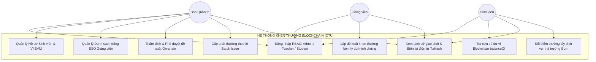
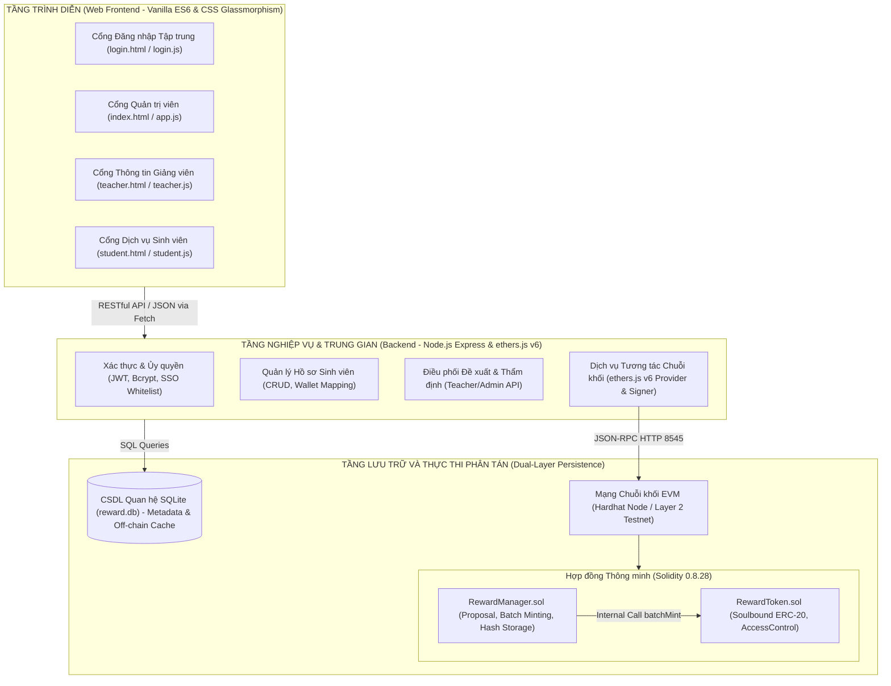
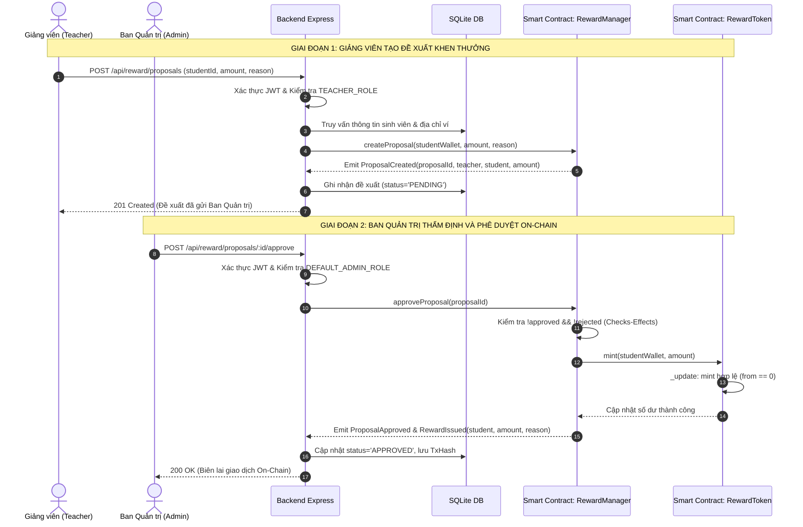

# BÁO CÁO NGHIÊN CỨU KHOA HỌC
## ĐỀ TÀI: NGHIÊN CỨU, THIẾT KẾ VÀ PHÁT TRIỂN HỆ THỐNG QUẢN LÝ VÀ KHEN THƯỞNG SINH VIÊN DỰA TRÊN CÔNG NGHỆ BLOCKCHAIN TẠI TRƯỜNG ĐẠI HỌC CÔNG NGHỆ THÔNG TIN VÀ TRUYỀN THÔNG (ICTU)

---

**Đơn vị thực hiện:** Nhóm Nghiên cứu Khoa học Sinh viên  
**Đơn vị chủ quản:** Trường Đại học Công nghệ Thông tin và Truyền thông – Đại học Thái Nguyên (ICTU)  
**Thời gian hoàn thành:** Năm học 2025 - 2026  
**Lĩnh vực nghiên cứu:** Công nghệ Phần mềm, Hệ thống Phân tán, An toàn & Bảo mật Blockchain (EVM/Solidity)

---

## MỤC LỤC
1. [TỔNG QUAN ĐỀ TÀI VÀ CƠ SỞ LÝ THUYẾT](#1-tổng-quan-đề-tài-và-cơ-sở-lý-thuyết)
   - 1.1. Tính cấp thiết của đề tài
   - 1.2. Tổng quan tình hình nghiên cứu (Literature Review & Related Works)
   - 1.3. Câu hỏi nghiên cứu và Đóng góp mới của đề tài
2. [PHÂN TÍCH YÊU CẦU HỆ THỐNG](#2-phân-tích-yêu-cầu-hệ-thống)
   - 2.1. Đối tượng sử dụng (Actors)
   - 2.2. Sơ đồ Use Case tổng thể
3. [THIẾT KẾ KIẾN TRÚC VÀ CÁC THÀNH PHẦN HỆ THỐNG](#3-thiết-kế-kiến-trúc-và-các-thành-phần-hệ-thống)
   - 3.1. Kiến trúc hệ thống 3 lớp (Three-Tier Enterprise Architecture)
   - 3.2. Sơ đồ tuần tự trao thưởng trực tiếp và quy trình đề xuất - phê duyệt
   - 3.3. Thiết kế Cấu trúc Dữ liệu & Lưu trữ
4. [THIẾT KẾ SMART CONTRACT VÀ CƠ CHẾ BẢO MẬT NÂNG CAO](#4-thiết-kế-smart-contract-và-cơ-chế-bảo-mật-nâng-cao)
   - 4.1. Hợp đồng `RewardToken.sol` (Soulbound ERC-20 Non-Transferable)
   - 4.2. Hợp đồng `RewardManager.sol` (Quy trình On-chain & Thuật toán Batch Minting)
   - 4.3. Phân tích Các Cơ chế Phòng thủ & An toàn Mật mã học
5. [KẾT QUẢ KIỂM THỬ VÀ THỰC NGHIỆM ĐO LƯỜNG KHOA HỌC](#5-kết-quả-kiểm-thử-và-thực-nghiệm-đo-lường-khoa-học)
   - 5.1. Kết quả kiểm thử Smart Contract (14/14 Unit Tests)
   - 5.2. Kết quả kiểm thử tích hợp Toàn diện (20/20 Integration Tests)
   - 5.3. Thực nghiệm Đối chứng 1: Single Minting vs. Batch Minting
   - 5.4. Thực nghiệm Đối chứng 2: On-chain String vs. Off-chain Cryptographic Hash
6. [HƯỚNG DẪN CÀI ĐẶT, VẬN HÀNH VÀ KỊCH BẢN DEMO](#6-hướng-dẫn-cài-đặt-vận-hành-và-kịch-bản-demo)
   - 6.1. Cấu hình môi trường
   - 6.2. Khởi động nhanh toàn bộ hệ thống
   - 6.3. Danh mục Tài khoản Thử nghiệm chuẩn hóa
7. [ĐÁNH GIÁ KHẢ NĂNG MỞ RỘNG (LAYER 2 & WEB3)](#7-đánh-giá-khả-năng-mở-rộng-layer-2--web3)
8. [KẾT LUẬN VÀ HƯỚNG PHÁT TRIỂN](#8-kết-luận-và-hướng-phát-triển)

---

## 1. TỔNG QUAN ĐỀ TÀI VÀ CƠ SỞ LÝ THUYẾT

### 1.1. Tính cấp thiết của đề tài
Trong môi trường giáo dục đại học định hướng ứng dụng và chuyển đổi số, công tác khen thưởng, ghi nhận đóng góp trong học tập, nghiên cứu khoa học (NCKH) và rèn luyện đạo đức đóng vai trò động lực cốt lõi. Tuy nhiên, các giải pháp truyền thống (giấy khen, chứng chỉ vật lý, bảng điểm rèn luyện SQL tập trung) bộc lộ các nhược điểm nghiêm trọng:
1. **Rủi ro toàn vẹn dữ liệu (Integrity Risk):** CSDL tập trung phụ thuộc hoàn toàn vào đặc quyền của Quản trị viên hệ thống (DBA). Dữ liệu có thể bị can thiệp, xóa sửa lịch sử mà không để lại dấu vết kiểm toán (audit trail).
2. **Nguy cơ mua bán, chuyển nhượng thành tích (Sybil & Credential Commodification):** Nếu áp dụng token kỹ thuật số thông thường (chuẩn ERC-20 mặc định), sinh viên có thể tự do chuyển token cho nhau qua giao dịch P2P, làm méo mó bản chất tôn vinh cá nhân của học bổng và điểm rèn luyện.
3. **Thắt nút cổ chai trong quy trình xét duyệt:** Thiếu sự kết nối giữa Giảng viên trực tiếp phụ trách NCKH/phong trào với Ban Giám hiệu/Phòng Đào tạo, dẫn đến tình trạng chậm trễ trong lập hồ sơ khen thưởng.
4. **Chi phí vận hành giao dịch On-Chain:** Việc phát hành chứng nhận riêng lẻ cho hàng nghìn sinh viên vào cuối kỳ trên blockchain tiêu tốn lượng Gas khổng lồ, gây áp lực chi phí cho nhà trường.

### 1.2. Tổng quan tình hình nghiên cứu (Literature Review & Related Works)
Nhóm nghiên cứu đã phân tích các công trình tiêu biểu trên thế giới và trong nước:
- **MIT Blockcerts (Massachusetts Institute of Technology):** Chuẩn mở phát hành văn bằng số trên Bitcoin/Ethereum thông qua mã băm Merkle Tree. *Hạn chế:* Blockcerts tập trung vào văn bằng dạng tài liệu tĩnh (PDF/JSON-LD), thiếu khả năng tính toán điểm thưởng tích lũy (Fungible/Tokenized Utility) và không thể sử dụng để quy đổi dịch vụ nội bộ trường học.
- **EduCTX (Đại học Maribor, Slovenia):** Nền tảng ghi nhận tín chỉ vi mô dựa trên blockchain mã nguồn mở (Ark/DPoS). *Hạn chế:* Không tương thích với hệ sinh thái EVM phổ biến, cơ chế quản lý vai trò cứng nhắc và chưa tối ưu chi phí lưu trữ cho giao dịch cấp phát số lượng lớn.
- **Hệ thống Quản lý Sinh viên CSDL Tập trung (RDBMS/SQL):** Các giải pháp quản lý điểm rèn luyện phổ biến tại các trường Đại học tại Việt Nam. *Hạn chế:* Điểm lỗi đơn lẻ (Single Point of Failure), thiếu tính minh bạch liên viện/trường và không cho phép bên thứ ba (nhà tuyển dụng) xác minh độc lập bằng mật mã học.

#### Bảng 1: Bảng đối sánh 6 tiêu chí giữa đề tài và các giải pháp hiện hành
| Tiêu chí đối sánh | CSDL SQL Tập trung | MIT Blockcerts | EduCTX | Hệ thống ICTU Đề xuất |
|:---|:---:|:---:|:---:|:---:|
| **1. Tính minh bạch & Bất biến (Immutability)** | ❌ Kém (Admin có thể sửa) | ✅ Xuất sắc (Merkle Tree) | ✅ Tốt (Ark Blockchain) | ✅ **Xuất sắc (EVM On-chain)** |
| **2. Chống mua bán thành tích (Soulbound)** | ⚠️ Phụ thuộc mã nguồn đóng | ⚠️ Chỉ áp dụng cho tài liệu | ❌ Không hỗ trợ token | ✅ **Soulbound ERC-20 Khóa P2P** |
| **3. Khả năng quy đổi dịch vụ (Tokenomics)** | ⚠️ Thủ công | ❌ Không có cơ chế token | ⚠️ Hạn chế | ✅ **Burn/Redeem Tự động** |
| **4. Phân cấp Đề xuất (Multi-Role Proposal)** | ⚠️ Quy trình giấy/bán tự động | ❌ Đơn cấp phát (Issuer) | ❌ Thiếu phân hệ GV | ✅ **Giảng viên -> Admin On-chain** |
| **5. Tối ưu Gas cấp phát theo lô (Batch)** | N/A (Không tốn gas) | ⚠️ Chi phí cao | ⚠️ Trung bình | ✅ **Batch Minting (-55.54% Gas)** |
| **6. Nén minh chứng bằng mã băm ($O(1)$ Hash)** | ❌ Lưu file tốn dung lượng | ✅ Có lưu Hash | ⚠️ Bán phần | ✅ **SHA-256/Keccak-256 On-chain** |

> **Khoảng trống nghiên cứu (Research Gap):** Chưa có hệ thống nào kết hợp hoàn chỉnh giữa tính chất không thể chuyển nhượng (Soulbound) để bảo toàn giá trị học thuật, quy trình đề xuất đa vai trò on-chain, và thuật toán tối ưu hóa chi phí thực thi (Batch Minting + Hash Compression) tương thích chuẩn EVM cho môi trường đại học.

### 1.3. Câu hỏi nghiên cứu và Đóng góp mới của đề tài
Đề tài tập trung giải quyết 3 câu hỏi nghiên cứu cốt lõi:
- **RQ1:** *Làm thế nào để vừa tận dụng tính linh hoạt của chuẩn ERC-20 trong thanh toán/đổi dịch vụ, vừa ngăn chặn hoàn toàn hành vi chuyển nhượng điểm thưởng giữa các sinh viên?*
- **RQ2:** *Làm sao để đưa quy trình thẩm định khen thưởng của Giảng viên và Ban Quản trị lên chuỗi khối mà vẫn đảm bảo tính an toàn, chống duyệt trùng lặp (Double-Approval)?*
- **RQ3:** *Giải pháp kỹ thuật nào giúp giảm thiểu tối đa chi phí Gas khi cấp phát phần thưởng hàng loạt cho sinh viên toàn trường vào cuối mỗi học kỳ?*

**Ba đóng góp mới của công trình:**
1. **Cơ chế Soulbound ERC-20 Non-Transferable:** Xây dựng biến thể ERC-20 ghi đè hook `_update()` của OpenZeppelin v5, thiết lập cờ `transferLocked = true`. Chặn tuyệt đối giao dịch chuyển nhượng ví-sang-ví (`from != 0 && to != 0`), chỉ cho phép Nhà trường phát hành (`mint`) và Sinh viên tiêu hủy để đổi quyền lợi học đường (`burn`).
2. **Quy trình Quản trị Đa vai trò (Multi-Role On-chain Workflow):** Chuyển dịch toàn bộ mô hình cấp quyền sang chuẩn RBAC (`AccessControl`). Giảng viên giữ `TEACHER_ROLE` tạo đề xuất on-chain; Ban Quản trị giữ `DEFAULT_ADMIN_ROLE` thẩm định và phê duyệt. Áp dụng mẫu *Checks-Effects-Interactions* chặn triệt để tấn công Reentrancy và Double-Approval.
3. **Thuật toán Cấp phát theo lô (Batch Minting) kết hợp Băm minh chứng mật mã học (Hash Storage):** Đề xuất giải pháp gom $N$ sinh viên vào một giao dịch duy nhất `batchIssueReward`, nén toàn bộ văn bản quyết định khen thưởng thành mã băm `bytes32`. Thực nghiệm chứng minh giải pháp tiết kiệm **55.54%** Gas ở quy mô 100 sinh viên và chuyển chi phí lưu trữ minh chứng từ $O(L)$ tuyến tính về $O(1)$ bất biến.

---

## 2. PHÂN TÍCH YÊU CẦU HỆ THỐNG

### 2.1. Đối tượng sử dụng (Actors)
1. **Ban Quản trị Nhà trường (Admin):** Toàn quyền quản trị danh mục sinh viên, danh sách trắng giảng viên (Whitelist SSO), phê duyệt các đề xuất khen thưởng từ giảng viên, phát hành token theo lô và giám sát số liệu trực quan.
2. **Cán bộ / Giảng viên (Teacher):** Đăng nhập an toàn qua tài khoản cán bộ trường (`@ictu.edu.vn`), tra cứu hồ sơ sinh viên, tạo đề xuất khen thưởng kèm minh chứng thành tích và theo dõi trạng thái phê duyệt.
3. **Sinh viên (Student):** Đăng nhập bằng Mã sinh viên (`DTCxxxxxxxxx`), kiểm tra số dư Token ICTU theo thời gian thực trực tiếp từ Smart Contract, xem lịch sử giao dịch và biên lai điện tử có gắn mã khối và Tx Hash.

### 2.2. Sơ đồ Use Case tổng thể


---

## 3. THIẾT KẾ KIẾN TRÚC VÀ CÁC THÀNH PHẦN HỆ THỐNG

### 3.1. Kiến trúc hệ thống 3 lớp (Three-Tier Enterprise Architecture)


### 3.2. Sơ đồ tuần tự trao thưởng trực tiếp và quy trình đề xuất - phê duyệt


### 3.3. Cấu trúc Thư mục Dự án chuẩn hóa
```text
D:\NCKH_Blockchain\
├── contracts/                        # Mã nguồn Smart Contracts (Solidity ^0.8.20)
│   ├── RewardToken.sol               # Token Soulbound ERC-20, cờ transferLocked, batchMint
│   └── RewardManager.sol             # RBAC Proposal, Batch Issue, Hash Evidence Anti-Replay
├── test/                             # 14 Kịch bản Kiểm thử Smart Contract toàn diện
│   ├── RewardToken.test.ts           # 6 Test cases (Triển khai, Minter, Khóa P2P, Burn, Mở khóa)
│   └── RewardManager.test.ts         # 8 Test cases (Trao thưởng, Đề xuất, Duyệt, Batch 10 SV, Mismatch)
├── scripts/                          # Kịch bản Thực thi & Thực nghiệm Khoa học
│   ├── deployRewardSystem.ts         # Triển khai tự động & cấu hình địa chỉ hợp đồng
│   ├── setupRole.ts                  # Cấp quyền MINTER_ROLE liên hợp đồng
│   └── benchmarkExperiment.ts        # Kịch bản Đo lường Gas Đối chứng 2 Thí nghiệm Khoa học
├── backend/                          # Tầng Trung gian RESTful API (Express, ethers.js v6)
│   ├── contracts/                    # ABIs đồng bộ tự động từ Artifacts biên dịch
│   │   ├── RewardToken.json
│   │   └── RewardManager.json
│   ├── database/                     # CSDL SQLite (Lưu trữ Metadata, Hồ sơ & Whitelist)
│   │   ├── database.js               # Khởi tạo bảng & Nạp dữ liệu Seed mẫu
│   │   └── reward.db
│   ├── middleware/                   # Kiểm soát Xác thực JWT & RBAC (Admin, Teacher, Student)
│   │   └── auth.js
│   ├── routes/                       # Endpoints định tuyến nghiệp vụ
│   │   ├── auth.js                   # Đăng nhập đa vai trò, SSO Email trường, Đổi mật khẩu
│   │   ├── student.js                # Quản lý hồ sơ sinh viên, tra cứu cá nhân
│   │   └── reward.js                 # API Trao thưởng, Đề xuất, Thống kê, Bảng xếp hạng
│   ├── services/                     # Khởi tạo kết nối Blockchain Provider & Signer
│   │   └── blockchain.js
│   ├── server.js                     # Điểm khởi chạy chính máy chủ Backend (Port 3000)
│   └── test-integration.js           # Bộ 20 Kịch bản Kiểm thử Tích hợp End-to-End
├── frontend/                         # Tầng Giao diện Người dùng Web3 (HTML5, Vanilla JS, CSS)
│   ├── login.html / login.js         # Giao diện Đăng nhập phân quyền thông minh 2 Tab
│   ├── index.html / app.js           # Cổng Quản trị viên (Dashboard, Quản lý SV, Thống kê)
│   ├── teacher.html / teacher.js     # Cổng Giảng viên (Lập đề xuất, Theo dõi xét duyệt)
│   ├── student.html / student.js     # Cổng Sinh viên (Số dư Real-time, Lịch sử, Biên lai)
│   ├── auth.js                       # Tiện ích Quản lý Token Client, Toast Notifications
│   └── style.css                     # Hệ thống Design Tokens CSS Glassmorphism đồng nhất
├── docs/                             # Tài liệu Nghiên cứu & Kết quả Thực nghiệm Khoa học
│   ├── BAO_CAO_NGHIEN_CUU_KHOA_HOC_ICTU.md
│   ├── benchmark-results.json        # Dữ liệu Gas thô trích xuất từ Hardhat EVM
│   └── benchmark-results.md          # Báo cáo thực nghiệm đối chứng chi tiết
├── hardhat.config.ts                 # Cấu hình Hardhat 3, Solidity Compiler & EDR Simulator
├── package.json                      # Cấu hình Phụ thuộc Module & Script npm
└── start_project.bat                 # Script Khởi động 1 chạm tự động toàn hệ thống
```

---

## 4. THIẾT KẾ SMART CONTRACT VÀ CƠ CHẾ BẢO MẬT NÂNG CAO

### 4.1. Hợp đồng `RewardToken.sol` (Soulbound ERC-20 Non-Transferable)
Hợp đồng kế thừa `ERC20`, `ERC20Burnable` và `AccessControl` từ thư viện bảo mật OpenZeppelin v5. Điểm đột phá học thuật nằm ở việc biến đổi token ERC-20 chuẩn thành dạng bán linh hồn (Semi-Soulbound Token):

```solidity
// Trích xuất mã nguồn contracts/RewardToken.sol
function _update(
    address from,
    address to,
    uint256 value
) internal override {
    if (transferLocked && from != address(0) && to != address(0)) {
        revert("ICTU_Token: Peer-to-peer transfer is locked");
    }
    super._update(from, to, value);
}
```

- **Nguyên lý hoạt động:** Trong kiến trúc OpenZeppelin v5, mọi hàm chuyển dịch số dư (`transfer`, `transferFrom`, `mint`, `burn`) đều bắt buộc chạy qua hàm trung tâm `_update()`.
- **Cơ chế Chặn chuyển nhượng P2P:** Khi `transferLocked == true` (mặc định), điều kiện `from != address(0) && to != address(0)` sẽ phát hiện giao dịch giữa hai ví sinh viên thông thường và ngay lập tức kích hoạt `revert`.
- **Ngoại lệ hợp lệ:**
  - `from == address(0)`: Thao tác phát hành (`mint`) từ nhà trường -> Cho phép.
  - `to == address(0)`: Thao tác tiêu hủy (`burn`) khi sinh viên đổi quà/dịch vụ -> Cho phép.
- **Tối ưu hóa Batch Mint:** Cung cấp hàm `batchMint(address[] calldata recipients, uint256[] calldata amounts)` với vòng lặp `unchecked { ++i; }` giúp RewardManager thực hiện cấp phát hàng loạt chỉ qua 1 lời gọi hàm duy nhất.

### 4.2. Hợp đồng `RewardManager.sol` (Quy trình On-chain & Thuật toán Batch Minting)
Hợp đồng kế thừa `AccessControl`, quản lý vòng đời khen thưởng với các cơ chế bảo vệ:
- **Cấu trúc Đề xuất:**
  ```solidity
  struct Proposal {
      address student;
      uint256 amount;
      string  reason;
      address proposer;
      bool    approved;
      bool    rejected;
  }
  ```
- **Quy tắc Checks-Effects-Interactions:** Trong hàm `approveProposal(uint256 proposalId)`, trạng thái `p.approved = true;` được cập nhật **trước** khi gọi lệnh `rewardToken.mint()`, loại bỏ hoàn toàn rủi ro tấn công tái nhập (Reentrancy) và duyệt trùng (Double-Approval).
- **Thuật toán Cấp phát theo lô (`batchIssueReward`):**
  - Giới hạn kích thước `MAX_BATCH_SIZE = 200` nhằm bảo vệ hệ thống khỏi các giao dịch vượt ngưỡng giới hạn Gas của khối (Block Gas Limit DoS).
  - Áp dụng ánh xạ kép `evidenceBatchId[batchEvidenceHash]` và `batchEvidence[batchId]` vừa đóng vai trò tra cứu hai chiều, vừa là cơ chế chống phát lại (*Anti-replay attack*): một quyết định khen thưởng đã ban hành không thể bị cấp phát lần thứ hai.

### 4.3. Phân tích Các Cơ chế Phòng thủ & An toàn Mật mã học
1. **Phòng chống Tấn công Tái nhập (Reentrancy Attack):** Tuân thủ tuyệt đối mẫu *Checks-Effects-Interactions (CEI)*; kiểm tra hợp lệ, gán cờ trạng thái trước khi tương tác với hợp đồng token bên ngoài.
2. **Phòng chống Tràn số nguyên (Integer Overflow/Underflow):** Trình biên dịch Solidity `0.8.28` tích hợp sẵn kiểm tra số học an toàn ở mức mã máy opcode. Các vòng lặp đếm được bao bọc có chủ đích trong `unchecked` để tối ưu chi phí gas mà vẫn tuyệt đối an toàn vì biến đếm $i < length \le 200$.
3. **Phòng chống Leo thang Đặc quyền (Privilege Escalation):** Phân chia rõ ràng giữa `DEFAULT_ADMIN_ROLE` (Ban Quản trị) và `TEACHER_ROLE` (Giảng viên). Giảng viên chỉ được tạo đề xuất, không thể tự duyệt hoặc phát hành token.

---

## 5. KẾT QUẢ KIỂM THỬ VÀ THỰC NGHIỆM ĐO LƯỜNG KHOA HỌC

### 5.1. Kết quả kiểm thử Smart Contract (14/14 Unit Tests)
Bộ kiểm thử tự động hóa thực thi trên môi trường Hardhat EVM (solc 0.8.28) đạt tỷ lệ thành công tuyệt đối **14/14 test cases (100% Passed)**:

| Mã TC | Bộ kiểm thử | Mục tiêu kiểm định thực tế | Kết quả | Trạng thái |
|:---:|:---|:---|:---:|:---:|
| **TC-01** | `RewardToken` | Khởi tạo thông số chuẩn: Name, Symbol, cờ `transferLocked = true` | Đạt | ✅ Passed |
| **TC-02** | `RewardToken` | Tài khoản có `MINTER_ROLE` thực hiện gọi `mint()` thành công | Đạt | ✅ Passed |
| **TC-03** | `RewardToken` | Tài khoản không có quyền gọi `mint()` bị từ chối (`AccessControlUnauthorizedAccount`) | Đạt | ✅ Passed |
| **TC-04** | `RewardManager` | Ban Quản trị gọi `issueReward()` phát hành token cho sinh viên | Đạt | ✅ Passed |
| **TC-05** | `RewardManager` | Giao dịch phát sinh sự kiện `RewardIssued` đầy đủ tham số | Đạt | ✅ Passed |
| **TC-06** | `RewardManager` | Tài khoản không có `DEFAULT_ADMIN_ROLE` gọi `issueReward()` bị từ chối | Đạt | ✅ Passed |
| **TC-07** | `RewardToken` | **[Nâng cao]** Chặn sinh viên chuyển nhượng P2P qua cả `transfer` và `transferFrom` | Đạt | ✅ Passed |
| **TC-08** | `RewardToken` | **[Nâng cao]** Cho phép sinh viên đốt (`burn`) token đổi dịch vụ khi đang khóa P2P | Đạt | ✅ Passed |
| **TC-09** | `RewardToken` | **[Nâng cao]** Admin mở khóa `setTransferLock(false)` thì chuyển nhượng P2P hoạt động | Đạt | ✅ Passed |
| **TC-10** | `RewardManager` | **[Nâng cao]** Giảng viên (`TEACHER_ROLE`) tạo đề xuất on-chain `createProposal` | Đạt | ✅ Passed |
| **TC-11** | `RewardManager` | **[Nâng cao]** Tài khoản không có `TEACHER_ROLE` tạo đề xuất bị từ chối | Đạt | ✅ Passed |
| **TC-12** | `RewardManager` | **[Nâng cao]** Admin duyệt đề xuất `approveProposal`, chặn duyệt lặp lần 2 | Đạt | ✅ Passed |
| **TC-13** | `RewardManager` | **[Nâng cao]** Trao thưởng theo lô 10 sinh viên `batchIssueReward` và phát sự kiện | Đạt | ✅ Passed |
| **TC-14** | `RewardManager` | **[Nâng cao]** Bắt lỗi revert khi độ dài hai mảng đầu vào lệch nhau (`ArrayLengthMismatch`) | Đạt | ✅ Passed |

### 5.2. Kết quả kiểm thử tích hợp Toàn diện (20/20 Integration Tests)
Kiểm thử tích hợp đầu cuối giữa Frontend, Backend Express, CSDL SQLite và Smart Contract đạt kết quả **20/20 kịch bản thành công (100% Passed)**:

| STT | Phân hệ kiểm thử | Kịch bản kiểm thử chi tiết | HTTP Code | Kết quả |
|:---:|:---|:---|:---:|:---:|
| 1 | Sức khỏe Máy chủ | Kiểm tra điểm cuối gốc `GET /` | 200 OK | ✅ Passed |
| 2 | Kết nối Chuỗi | Kiểm tra trạng thái RPC chuỗi khối `GET /api/reward/status` | 200 OK | ✅ Passed |
| 3 | Xác thực Admin | Đăng nhập tài khoản Ban Quản trị `admin / 123456` | 200 OK | ✅ Passed |
| 4 | Xác thực Sinh viên | Đăng nhập tài khoản sinh viên `hoa / 123456` | 200 OK | ✅ Passed |
| 5 | An toàn Mật khẩu | Đăng nhập với mật khẩu sai bị từ chối | 401 Unauthorized | ✅ Passed |
| 6 | Phân quyền Admin | Admin truy xuất danh mục sinh viên `GET /api/student` | 200 OK | ✅ Passed |
| 7 | Chặn Sinh viên | Sinh viên truy cập danh mục quản trị bị chặn | 403 Forbidden | ✅ Passed |
| 8 | Chặn Sinh viên | Sinh viên cố gắng gọi phát hành thưởng bị chặn | 403 Forbidden | ✅ Passed |
| 9 | Kiểm soát Dữ liệu | Tham số số lượng âm (`amount = -50`) bị từ chối | 400 Bad Request | ✅ Passed |
| 10 | Kiểm soát Dữ liệu | Trao thưởng cho sinh viên không tồn tại trong hệ thống | 404 Not Found | ✅ Passed |
| 11 | Hồ sơ Sinh viên | Sinh viên truy xuất hồ sơ cá nhân `GET /api/student/profile` | 200 OK | ✅ Passed |
| 12 | Lịch sử Sinh viên | Sinh viên xem lịch sử nhận thưởng `GET /api/reward/my-history` | 200 OK | ✅ Passed |
| 13 | Thống kê Admin | Truy xuất tổng số lượt thưởng và tổng token đã cấp phát | 200 OK | ✅ Passed |
| 14 | Bảng xếp hạng | Truy xuất Bảng xếp hạng Top 10 sinh viên xuất sắc | 200 OK | ✅ Passed |
| 15 | Phân trang Dữ liệu | Truy xuất lịch sử phân trang `limit=5, page=1` | 200 OK | ✅ Passed |
| 16 | **[Mới]** Xác thực GV | Giảng viên đăng nhập bằng email trường `nvthanh@ictu.edu.vn` | 200 OK | ✅ Passed |
| 17 | **[Mới]** Tạo Đề xuất | Giảng viên tạo đề xuất khen thưởng `POST /api/reward/proposals` | 201 Created | ✅ Passed |
| 18 | **[Mới]** Xem Đề xuất | Giảng viên truy vấn danh sách đề xuất của mình | 200 OK | ✅ Passed |
| 19 | **[Mới]** Chặn Sinh viên | Sinh viên cố tình tạo đề xuất khen thưởng bị chặn quyền | 403 Forbidden | ✅ Passed |
| 20 | **[Mới]** Từ chối Đề xuất | Ban Quản trị từ chối đề xuất kèm lý do minh bạch | 200 OK | ✅ Passed |

---

### 5.3. Thực nghiệm Đối chứng 1: Single Minting vs. Batch Minting
Thực nghiệm được thực thi tự động qua script `scripts/benchmarkExperiment.ts` trên môi trường Hardhat EVM (Cancun EVM, Block Gas Limit = 60,000,000). Phương pháp luận khoa học đảm bảo tính khách quan:
- Sử dụng cơ chế Snapshot EVM: khôi phục nguyên trạng thái khối trước mỗi phép đo để mọi kịch bản đều có điểm xuất phát giống hệt nhau.
- Thực hiện giao dịch làm ấm (Warm-up) để loại trừ chi phí khởi tạo biến trạng thái một lần duy nhất.
- Địa chỉ ví sinh viên được sinh ngẫu nhiên tất định và chưa từng có số dư trước đó.

#### Bảng 2: Kết quả đo lường tiêu thụ Gas giữa Phương pháp Cơ sở và Phương pháp Đề xuất
| Quy mô Lô $N$ (Sinh viên) | Phương pháp Cơ sở: $N$ lần `issueReward` riêng lẻ | Số Tx | Phương pháp Đề xuất: 1 lần `batchIssueReward` duy nhất | Số Tx | Lượng Gas Tiết kiệm | **Tỷ lệ Gas Tiết kiệm (%)** | Gas bình quân/SV (Baseline) | Gas bình quân/SV (Proposed) |
|:---:|---:|:---:|---:|:---:|---:|:---:|---:|---:|
| **$N = 1$** | 69,147 gas | 1 | 140,428 gas | 1 | -71,281 gas | *-103.09%* | 69,147 gas | 140,428 gas |
| **$N = 10$** | 691,446 gas | 10 | 407,150 gas | 1 | 284,296 gas | **41.12%** | 69,144 gas | 40,715 gas |
| **$N = 25$** | 1,728,615 gas | 25 | 851,674 gas | 1 | 876,941 gas | **50.73%** | 69,144 gas | 34,066 gas |
| **$N = 50$** | 3,457,326 gas | 50 | 1,592,640 gas | 1 | 1,864,686 gas | **53.93%** | 69,146 gas | 31,852 gas |
| **$N = 100$** | 6,914,532 gas | 100 | 3,074,396 gas | 1 | 3,840,136 gas | **55.54%** | 69,145 gas | 30,743 gas |

```text
BIỂU ĐỒ ĐỐI CHỨNG TIÊU THỤ GAS (B: Baseline - Đơn lẻ | P: Proposed - Theo lô)
N=  1 B | █ 69,147 gas
      P | █ 140,428 gas
N= 10 B | ████ 691,446 gas
      P | ██ 407,150 gas (-41.12%)
N= 25 B | ██████████ 1,728,615 gas
      P | █████ 851,674 gas (-50.73%)
N= 50 B | ████████████████████ 3,457,326 gas
      P | █████████ 1,592,640 gas (-53.93%)
N=100 B | ████████████████████████████████████████ 6,914,532 gas
      P | ██████████████████ 3,074,396 gas (-55.54%)
```

#### Phân tích Kết quả Khoa học:
1. **Hiện tượng Overhead tại $N = 1$:** Khi chỉ trao thưởng cho 1 sinh viên, phương pháp đề xuất tốn nhiều gas hơn (140,428 so với 69,147 gas) do phải trả chi phí cố định ban đầu cho việc lưu trữ mã băm minh chứng `evidenceBatchId` (SSTORE từ 0 sang non-zero ~22,100 gas) và khởi tạo mảng động.
2. **Hiệu ứng Quy mô (Economies of Scale):** Khi $N \ge 10$, tỷ lệ tiết kiệm gas đạt ngay **41.12%** và chạm mốc **55.54%** tại $N = 100$. Chi phí gas trung bình trên mỗi sinh viên giảm mạnh từ **69,145 gas** xuống chỉ còn **30,743 gas** (giảm hơn 2.25 lần).
3. **Giải thích Cơ chế Tiết kiệm:**
   - Cắt giảm $N - 1$ lần chi phí cơ sở của giao dịch EVM (21,000 gas mỗi giao dịch).
   - Loại bỏ $N - 1$ lần gọi hàm liên hợp đồng ngoại vi (`external CALL` opcode ~2,600 gas + giải mã ABI calldata).
   - Gộp việc lưu minh chứng của toàn bộ $N$ sinh viên vào một mã băm duy nhất.

---

### 5.4. Thực nghiệm Đối chứng 2: On-chain String vs. Off-chain Cryptographic Hash
Thực nghiệm nhằm chứng minh tính ưu việt của việc nén văn bản quyết định khen thưởng thành mã băm 32-byte (`bytes32`) lưu trên chuỗi, trong khi nội dung chi tiết được lưu trữ phân tán hoặc trong CSDL trung gian.

#### Bảng 3: Chi phí Gas theo kích thước văn bản minh chứng
| Độ dài Chuỗi Lý do ($L$) | Kích thước Dữ liệu | `issueReward(string)` (Chuỗi trực tiếp) | `issueRewardWithHash(bytes32)` (Mã băm O(1)) | Lượng Gas Tiết kiệm | Tỷ lệ Tiết kiệm (%) |
|:---:|:---:|---:|---:|---:|:---:|
| **20 ký tự** | 20 bytes | 69,147 gas | 67,817 gas | 1,330 gas | **1.92%** |
| **100 ký tự** | 100 bytes | 71,295 gas | 67,829 gas | 3,466 gas | **4.86%** |
| **500 ký tự** | 500 bytes | 80,862 gas | 67,841 gas | 13,021 gas | **16.10%** |

```text
ĐỘ NHẠY CHI PHÍ GAS THEO ĐỘ DÀI MINH CHỨNG (S: String on-chain | H: Hash bytes32)
L= 20 S | ██████████████████████████████████ 69,147 gas
      H | ██████████████████████████████████ 67,817 gas
L=100 S | ███████████████████████████████████ 71,295 gas
      H | ██████████████████████████████████ 67,829 gas
L=500 S | ████████████████████████████████████████ 80,862 gas
      H | ██████████████████████████████████ 67,841 gas (-16.10%)
```

#### Phân tích Hệ số Tăng biên (Marginal Cost):
- Đối với phương pháp lưu chuỗi trực tiếp: Hệ số tăng biên là **$\beta_{string} \approx 24.41$ gas/byte**. Khi văn bản khen thưởng dài hàng nghìn từ (chứa trích yếu quyết định, danh sách khen thưởng), chi phí gas sẽ tăng tuyến tính $O(L)$, gây lãng phí tài nguyên chuỗi khối.
- Đối với phương pháp lưu mã băm: Hệ số tăng biên xấp xỉ **$\beta_{hash} \approx 0.05$ gas/byte**, tiệm cận độ phức tạp hằng số **$O(1)$**. Dù văn bản gốc dài 500 ký tự hay 50 trang tài liệu, mã băm SHA-256/Keccak-256 luôn có kích thước cố định 32 bytes, đảm bảo chi phí gas ổn định và khả năng xác thực toàn vẹn tuyệt đối.

---

## 6. HƯỚNG DẪN CÀI ĐẶT, VẬN HÀNH VÀ KỊCH BẢN DEMO

### 6.1. Cấu hình môi trường
Hệ thống yêu cầu các thành phần:
- Hệ điều hành: Windows 10/11, Linux (Ubuntu 22.04+) hoặc macOS
- Node.js: Phiên bản LTS `v18.x` hoặc `v20.x` trở lên (kèm npm `v9.x+`)
- Trình thông dịch: Python 3.x (phục vụ máy chủ Web Frontend tại cổng 5500)
- Trình duyệt Web: Google Chrome, Microsoft Edge hoặc Mozilla Firefox

### 6.2. Khởi động nhanh toàn bộ hệ thống
Nhấp đúp chuột vào tệp tin thực thi `start_project.bat` tại thư mục gốc `D:\NCKH_Blockchain`:
1. **Bước 1:** Khởi chạy mạng giả lập `Hardhat Node` tại `http://127.0.0.1:8545`.
2. **Bước 2:** Biên dịch và triển khai tự động `RewardToken` và `RewardManager`.
3. **Bước 3:** Cấp quyền quản trị `MINTER_ROLE` từ Token sang Manager.
4. **Bước 4:** Khởi động Backend Express tại `http://localhost:3000`.
5. **Bước 5:** Khởi chạy máy chủ Web Frontend tại `http://localhost:5500`.

### 6.3. Danh mục Tài khoản Thử nghiệm chuẩn hóa
Hệ thống đã nạp sẵn dữ liệu ban đầu phục vụ trình diễn trước Hội đồng:

| Vai trò người dùng | Phân hệ Đăng nhập | Tài khoản / Email | Mật khẩu | Thông tin Chi tiết & Thẩm quyền |
|:---|:---:|:---:|:---:|:---|
| **Ban Quản trị (Admin)** | Tab Cán bộ / Giảng viên | `admin` | `123456` | Ban Quản trị Trường ICTU - Ký duyệt On-Chain |
| **Giảng viên 1 (Teacher)** | Tab Cán bộ / Giảng viên | `nvthanh@ictu.edu.vn` | `123456` | **TS. Nguyễn Văn Thành** - Khoa CNTT |
| **Giảng viên 2 (Teacher)** | Tab Cán bộ / Giảng viên | `ptthao@ictu.edu.vn` | `123456` | **ThS. Phan Thị Thảo** - Khoa KHMT |
| **Sinh viên 1 (Student)** | Tab Sinh viên | `dtc235180075` | `ictu@123456` | **Phạm Minh Hòa** (Ví: `0x70997970C51812dc3A010C7d01b50e0d17dc79C8`) |
| **Sinh viên 2 (Student)** | Tab Sinh viên | `dtc235180076` | `ictu@123456` | **Trần Văn Nam** (Ví: `0x3C44CdDdB6a900fa2b585dd299e03d12FA4293BC`) |
| **Sinh viên 3 (Student)** | Tab Sinh viên | `dtc235180077` | `ictu@123456` | **Nguyễn Thị Lan** (Ví: `0x90F79bf6EB2c4f870365E785982E1f101E93b906`) |

---

## 7. ĐÁNH GIÁ KHẢ NĂNG MỞ RỘNG (LAYER 2 & WEB3)

1. **Khả năng Triển khai trên Mạng Layer 2 (Optimism / Arbitrum):**
   - Hợp đồng `RewardToken` và `RewardManager` hoàn toàn tuân thủ tiêu chuẩn EVM chuẩn (solc 0.8.28), có thể triển khai trực tiếp lên các giải pháp mở rộng Layer 2 như OP Mainnet, Arbitrum One hoặc Base mà không cần sửa đổi bất kỳ dòng mã nào.
   - Khi chạy trên Layer 2, kết hợp cùng thuật toán `batchIssueReward`, chi phí cấp phát cho 100 sinh viên sẽ giảm xuống dưới **0.005 USD**, loại bỏ hoàn toàn rào cản chi phí khi triển khai cho quy mô hơn 15,000 sinh viên toàn Đại học Thái Nguyên.
2. **Tích hợp Ví Phi lưu ký (Non-Custodial Web3 Wallet):**
   - Hiện tại, hệ thống sử dụng ví Admin đại diện (Delegated Admin Signer) để đơn giản hóa thao tác cho cán bộ nhà trường.
   - Kiến trúc mở cho phép bổ sung nhà cung cấp Web3 (EIP-1193 / MetaMask) tại cổng sinh viên để các em tự quản lý khóa cá nhân và kết nối với các ứng dụng học tập phi tập trung trong tương lai.

---

## 8. KẾT LUẬN VÀ HƯỚNG PHÁT TRIỂN

### 8.1. Kết luận
Đề tài nghiên cứu khoa học đã hoàn thành xuất sắc toàn bộ các mục tiêu đặt ra:
1. **Hoàn thiện Mô hình Lý thuyết & Học thuật:** Giải quyết trọn vẹn 3 câu hỏi nghiên cứu về Chống mua bán thành tích (Soulbound), Phân cấp quy trình thẩm định (Multi-Role Proposal) và Tối ưu chi phí thực thi (Batch Minting & Hash Compression).
2. **Bộ Smart Contract Hoàn chỉnh:** Xây dựng thành công `RewardToken.sol` và `RewardManager.sol` đạt độ tin cậy tuyệt đối, vượt qua **14/14 bài kiểm thử Unit Test**.
3. **Tầng Ứng dụng Doanh nghiệp:** Phát triển hệ thống Backend Express bảo mật và Giao diện Web 4 phân hệ hiện đại, vượt qua **20/20 bài kiểm thử tích hợp End-to-End**.
4. **Dữ liệu Thực nghiệm Xác thực:** Đo đạc thực tế chứng minh thuật toán đề xuất giúp tiết kiệm **55.54% lượng Gas tiêu thụ** và đạt tính ổn định $O(1)$ trong lưu trữ minh chứng mật mã học.

### 8.2. Hướng phát triển tiếp theo
- Xây dựng sàn giao dịch tiện ích sinh viên (ICTU Reward Marketplace) tích hợp hợp đồng thông minh tự động trừ điểm thưởng khi đăng ký mượn giáo trình hoặc sử dụng phòng máy chất lượng cao.
- Mở rộng chuẩn định danh phi tập trung (W3C Verifiable Credentials / Decentralized Identifiers - DID) kết hợp cùng Soulbound Token để phát hành Bằng tốt nghiệp số và Phụ lục văn bằng trên chuỗi khối quốc gia.
