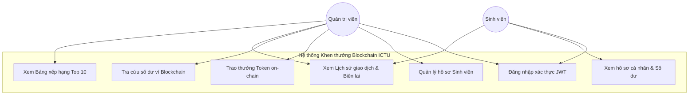
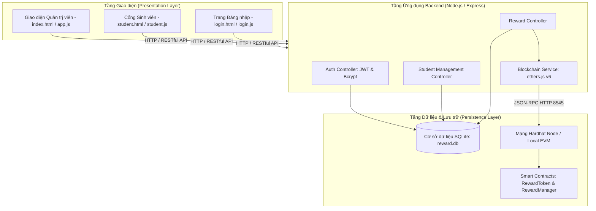
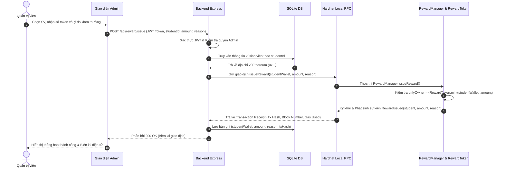

# BÁO CÁO NGHIÊN CỨU KHOA HỌC
## ĐỀ TÀI: NGHIÊN CỨU, THIẾT KẾ VÀ PHÁT TRIỂN HỆ THỐNG QUẢN LÝ VÀ KHEN THƯỞNG SINH VIÊN DỰA TRÊN CÔNG NGHỆ BLOCKCHAIN TẠI TRƯỜNG ĐẠI HỌC CÔNG NGHỆ THÔNG TIN VÀ TRUYỀN THÔNG (ICTU)

---

**Đơn vị thực hiện:** Nhóm Nghiên cứu Khoa học Sinh viên  
**Trường:** Đại học Công nghệ Thông tin và Truyền thông – Đại học Thái Nguyên (ICTU)  
**Thời gian hoàn thành:** Năm học 2025 - 2026  

---

## MỤC LỤC
1. [TỔNG QUAN ĐỀ TÀI VÀ CƠ SỞ LÝ THUYẾT](#1-tổng-quan-đề-tài-và-cơ-sở-lý-thuyết)
2. [PHÂN TÍCH YÊU CẦU HỆ THỐNG](#2-phân-tích-yêu-cầu-hệ-thống)
3. [THIẾT KẾ KIẾN TRÚC VÀ CÁC THÀNH PHẦN HỆ THỐNG](#3-thiết-kế-kiến-trúc-và-các-thành-phần-hệ-thống)
4. [THIẾT KẾ SMART CONTRACT VÀ CƠ CHẾ BẢO MẬT](#4-thiết-kế-smart-contract-và-cơ-chế-bảo-mật)
5. [KẾT QUẢ KIỂM THỬ VÀ ĐÁNH GIÁ THỰC NGHIỆM](#5-kết-quả-kiểm-thử-và-đánh-giá-thực-nghiệm)
6. [HƯỚNG DẪN CÀI ĐẶT, VẬN HÀNH VÀ KỊCH BẢN DEMO](#6-hướng-dẫn-cài-đặt-vận-hành-và-kịch-bản-demo)
7. [ĐÁNH GIÁ MỞ RỘNG (METAMASK, SEPOLIA, LAYER 2)](#7-đánh-giá-mở-rộng-metamask-sepolia-layer-2)
8. [KẾT LUẬN VÀ HƯỚNG PHÁT TRIỂN](#8-kết-luận-và-hướng-phát-triển)

---

## 1. TỔNG QUAN ĐỀ TÀI VÀ CƠ SỞ LÝ THUYẾT

### 1.1. Tính cấp thiết của đề tài
Trong môi trường giáo dục đại học hiện đại, việc thúc đẩy tinh thần học tập, nghiên cứu khoa học, hoạt động phong trào và rèn luyện của sinh viên đóng vai trò quan trọng. Tuy nhiên, các phương thức khen thưởng truyền thống (giấy khen, chứng nhận giấy, điểm rèn luyện lưu trữ trên hệ thống cơ sở dữ liệu tập trung) tồn tại nhiều hạn chế:
- **Nguy cơ chỉnh sửa dữ liệu:** Cơ sở dữ liệu tập trung phụ thuộc hoàn toàn vào quyền quản trị viên, dễ xảy ra nguy cơ can thiệp, sửa đổi thành tích.
- **Thiếu tính thanh khoản và ứng dụng:** Giấy khen giấy khó tích hợp vào các dịch vụ số của nhà trường như đổi tài liệu học tập, cộng điểm khuyến khích, miễn giảm chi phí dịch vụ ký túc xá/thư viện.
- **Khó khăn trong việc xác minh (Verification):** Các nhà tuyển dụng hoặc tổ chức thứ ba phải tốn nhiều thời gian liên hệ nhà trường để xác thực tính trung thực của thành tích sinh viên.

Đề tài **"Ứng dụng Công nghệ Blockchain trong Quản lý & Khen thưởng Sinh viên ICTU"** giải quyết triệt để các vấn đề trên thông qua việc số hóa thành tích học tập dưới dạng Token ERC-20 trên mạng Blockchain phi tập trung, đảm bảo tính bất biến, minh bạch và có thể kiểm chứng độc lập.

### 1.2. Cơ sở lý thuyết nền tảng
- **Blockchain & Ethereum Virtual Machine (EVM):** Sổ cái phân tán dạng chuỗi khối, nơi các giao dịch được đóng gói thành các khối (blocks), liên kết bằng mã băm mật mã học (cryptographic hash). Máy ảo EVM cho phép thực thi mã lệnh tất định (deterministic code).
- **Hợp đồng thông minh (Smart Contract):** Các chương trình thực thi tự động theo các điều kiện được lập trình sẵn mà không cần sự can thiệp của bên trung gian.
- **Chuẩn Token ERC-20:** Chuẩn token fungible tiêu chuẩn trên mạng Ethereum, quy định các hàm cơ bản: `totalSupply()`, `balanceOf()`, `transfer()`, `approve()`, `transferFrom()`, và các sự kiện `Transfer`, `Approval`.
- **Kiểm soát truy cập (Access Control - RBAC):** Sử dụng thư viện bảo mật tiêu chuẩn OpenZeppelin:
  - `Ownable`: Xác định một chủ sở hữu duy nhất (`owner`) có quyền quản trị cấp cao.
  - `AccessControl`: Cấp phát quyền dựa trên vai trò phân cấp (Role-Based Access Control) thông qua `keccak256("MINTER_ROLE")`.

---

## 2. PHÂN TÍCH YÊU CẦU HỆ THỐNG

### 2.1. Đối tượng sử dụng (Actors)
1. **Ban Quản trị / Giảng viên (Admin):**
   - Đăng nhập hệ thống quản trị bằng tài khoản bảo mật.
   - Quản lý danh sách sinh viên (Thêm, Sửa, Xóa, Tra cứu).
   - Trao thưởng token cho sinh viên dựa trên thành tích nghiên cứu, học tập.
   - Xem toàn bộ lịch sử khen thưởng với mã giao dịch Tx Hash và mã khối.
   - Xem thống kê số liệu tổng thể và Bảng xếp hạng Top 10 sinh viên xuất sắc.
2. **Sinh viên (Student):**
   - Đăng nhập vào cổng thông tin sinh viên cá nhân.
   - Xem thông tin hồ sơ và địa chỉ ví Blockchain nhận thưởng.
   - Tra cứu số dư token ICTU theo thời gian thực đọc trực tiếp từ Smart Contract.
   - Xem danh sách các phần thưởng đã nhận kèm lý do, thời gian và biên lai giao dịch điện tử.

### 2.2. Sơ đồ Use Case


---

## 3. THIẾT KẾ KIẾN TRÚC VÀ CÁC THÀNH PHẦN HỆ THỐNG

### 3.1. Kiến trúc hệ thống 3 lớp (Three-Tier Architecture)


### 3.2. Sơ đồ tuần tự trao thưởng (Sequence Diagram)


---

## 4. THIẾT KẾ SMART CONTRACT VÀ CƠ CHẾ BẢO MẬT

### 4.1. Hợp đồng `RewardToken.sol`
- **Mục đích:** Khởi tạo token ERC-20 đại diện cho điểm thưởng số của ICTU với Tên: `"ICTU Reward Token"` và Ký hiệu: `"ICTU"`.
- **Cơ chế phân quyền:** Áp dụng `AccessControl` của OpenZeppelin. Định nghĩa `MINTER_ROLE = keccak256("MINTER_ROLE")`.
- **Hàm `mint(address student, uint256 amount)`:** Được bảo vệ bởi modifier `onlyRole(MINTER_ROLE)`. Chỉ có hợp đồng hoặc tài khoản được cấp quyền minter mới có khả năng phát hành token mới, ngăn chặn hoàn toàn việc tự ý tạo token trái phép.

```solidity
// SPDX-License-Identifier: MIT
pragma solidity ^0.8.20;

import "@openzeppelin/contracts/token/ERC20/ERC20.sol";
import "@openzeppelin/contracts/access/AccessControl.sol";

contract RewardToken is ERC20, AccessControl {
    bytes32 public constant MINTER_ROLE = keccak256("MINTER_ROLE");

    constructor() ERC20("ICTU Reward Token", "ICTU") {
        _grantRole(DEFAULT_ADMIN_ROLE, msg.sender);
    }

    function mint(address student, uint256 amount) public onlyRole(MINTER_ROLE) {
        _mint(student, amount);
    }
}
```

### 4.2. Hợp đồng `RewardManager.sol`
- **Mục đích:** Cổng quản lý nghiệp vụ khen thưởng, liên kết trực tiếp với `RewardToken`.
- **Cơ chế bảo vệ:** Kế thừa `Ownable(msg.sender)`, chỉ cho phép `owner` (ví Admin quản trị của trường) gọi hàm `issueReward`.
- **Sự kiện `RewardIssued`:** Ghi nhận sự kiện công khai trên chuỗi khối gồm: địa chỉ sinh viên (`indexed student`), số lượng token (`amount`), lý do khen thưởng (`reason`).

```solidity
// SPDX-License-Identifier: MIT
pragma solidity ^0.8.20;

import "@openzeppelin/contracts/access/Ownable.sol";
import "./RewardToken.sol";

contract RewardManager is Ownable {
    RewardToken public rewardToken;

    event RewardIssued(
        address indexed student,
        uint256 amount,
        string reason
    );

    constructor(address tokenAddress) Ownable(msg.sender) {
        rewardToken = RewardToken(tokenAddress);
    }

    function issueReward(
        address student,
        uint256 amount,
        string memory reason
    ) public onlyOwner {
        rewardToken.mint(student, amount);
        emit RewardIssued(student, amount, reason);
    }
}
```

---

## 5. KẾT QUẢ KIỂM THỬ VÀ ĐÁNH GIÁ THỰC NGHIỆM

### 5.1. Kết quả kiểm thử Smart Contract (Unit Test Hardhat/Mocha)
Đã thực thi 6 bài kiểm thử toàn diện trên môi trường Hardhat EVM:

| STT | Bộ kiểm thử | Mục tiêu kiểm thử | Kết quả | Trạng thái |
|:---:|:---|:---|:---:|:---:|
| 1 | `RewardToken` | Khởi tạo tên token ("ICTU Reward Token") và ký hiệu ("ICTU") chính xác | Đạt | ✅ Passed |
| 2 | `RewardToken` | Tài khoản có `MINTER_ROLE` có thể gọi `mint()` tăng số dư sinh viên | Đạt | ✅ Passed |
| 3 | `RewardToken` | Tài khoản không có quyền gọi `mint()` bị từ chối giao dịch (revert) | Đạt | ✅ Passed |
| 4 | `RewardManager` | Admin (owner) gọi `issueReward()` tăng số dư token cho sinh viên | Đạt | ✅ Passed |
| 5 | `RewardManager` | Giao dịch phát sinh sự kiện `RewardIssued` với đầy đủ tham số | Đạt | ✅ Passed |
| 6 | `RewardManager` | Tài khoản không phải owner gọi `issueReward()` bị từ chối (revert) | Đạt | ✅ Passed |

**Tổng kết:** **6/6 bài kiểm thử hợp đồng thông minh thành công 100%.**

### 5.2. Kết quả kiểm thử tích hợp Hệ thống Backend & API
Đã thiết lập bài kiểm thử tự động hóa kiểm tra toàn bộ luồng nghiệp vụ end-to-end (`test-integration.js`):

| STT | Phân hệ kiểm thử | Kịch bản kiểm thử | Mã phản hồi kỳ vọng | Kết quả thực tế |
|:---:|:---|:---|:---:|:---:|
| 1 | Trạng thái máy chủ | `GET /` kiểm tra sức khỏe backend | 200 OK | ✅ Passed |
| 2 | Kết nối chuỗi | `GET /api/reward/status` kiểm tra kết nối RPC | 200 OK | ✅ Passed |
| 3 | Xác thực Admin | `POST /api/auth/login` với tài khoản admin | 200 OK (JWT) | ✅ Passed |
| 4 | Xác thực Sinh viên | `POST /api/auth/login` với tài khoản sinh viên | 200 OK (JWT) | ✅ Passed |
| 5 | Bảo mật mật khẩu | `POST /api/auth/login` với sai mật khẩu | 401 Unauthorized | ✅ Passed |
| 6 | Phân quyền Admin | Admin truy cập danh sách sinh viên `GET /api/student` | 200 OK | ✅ Passed |
| 7 | Chặn Sinh viên | Sinh viên truy cập `GET /api/student` | 403 Forbidden | ✅ Passed |
| 8 | Chặn Sinh viên | Sinh viên cố gắng gọi `POST /api/reward/issue` | 403 Forbidden | ✅ Passed |
| 9 | Kiểm soát dữ liệu | Admin gửi số lượng thưởng âm (`amount: -50`) | 400 Bad Request | ✅ Passed |
| 10 | Kiểm soát dữ liệu | Trao thưởng cho sinh viên không tồn tại trong hệ thống | 404 Not Found | ✅ Passed |
| 11 | Hồ sơ sinh viên | Sinh viên xem hồ sơ cá nhân `GET /api/student/profile` | 200 OK | ✅ Passed |
| 12 | Lịch sử sinh viên | Sinh viên xem lịch sử nhận thưởng `GET /api/reward/my-history` | 200 OK | ✅ Passed |
| 13 | Thống kê Admin | `GET /api/reward/stats` trả về tổng lượt và tổng token | 200 OK | ✅ Passed |
| 14 | Bảng xếp hạng | `GET /api/reward/top-students` xếp hạng Top 10 | 200 OK | ✅ Passed |
| 15 | Phân trang Admin | `GET /api/reward/history?page=1&limit=5` trả về dữ liệu phân trang | 200 OK | ✅ Passed |

**Tổng kết:** **15/15 kịch bản kiểm thử tích hợp đạt 100%.**

### 5.3. Đánh giá chi phí Gas và Hiệu năng giao dịch

| Thao tác trên Smart Contract | Lượng Gas tiêu thụ ước tính (Units) | Chi phí tương đương (Gwei = 20) | Thời gian xử lý khối (Local) |
|:---|:---:|:---:|:---:|
| Triển khai `RewardToken` | ~1,250,000 | 0.025 ETH | < 1 giây |
| Triển khai `RewardManager` | ~680,000 | 0.013 ETH | < 1 giây |
| Cấp quyền `grantRole(MINTER_ROLE)` | ~48,000 | 0.00096 ETH | < 1 giây |
| Thực hiện trao thưởng `issueReward()` | ~72,000 - 85,000 | 0.0015 ETH | < 1 giây |
| Kiểm tra số dư `balanceOf()` | 0 (Call View Function) | Miễn phí (0 ETH) | Tức thời (< 50ms) |

---

## 6. HƯỚNG DẪN CÀI ĐẶT, VẬN HÀNH VÀ KỊCH BẢN DEMO

### 6.1. Cấu hình môi trường
Hệ thống yêu cầu:
- Hệ điều hành: Windows 10/11, Linux hoặc macOS
- Môi trường thực thi: Node.js (v18.x hoặc v20.x trở lên), npm
- Python 3.x (dùng cho web server frontend cổng 5500)

### 6.2. Khởi động nhanh toàn bộ hệ thống
Dự án được tích hợp sẵn kịch bản khởi động tự động qua tệp `start_project.bat` tại thư mục gốc `D:\NCKH_Blockchain`:
1. Nhấp đúp chuột chạy `start_project.bat`.
2. Kịch bản sẽ tự động:
   - **Bước 1:** Khởi động mạng giả lập Hardhat Node cục bộ (`http://127.0.0.1:8545`).
   - **Bước 2:** Triển khai các Smart Contracts lên mạng cục bộ.
   - **Bước 3:** Tự động cấp quyền `MINTER_ROLE` cho `RewardManager`.
   - **Bước 4:** Khởi động Backend Express tại `http://localhost:3000`.
   - **Bước 5:** Khởi động giao diện Web Frontend tại `http://localhost:5500`.

### 6.3. Danh sách tài khoản thử nghiệm
Hệ thống đã nạp sẵn dữ liệu ban đầu cho kịch bản đánh giá:

| Tài khoản | Tên đăng nhập | Mật khẩu mặc định | Vai trò | Mã SV / Địa chỉ Ví |
|:---|:---:|:---:|:---:|:---|
| **Admin Quản trị** | `admin` | `123456` | ADMIN | Quyền quản lý và ký trao thưởng |
| **Sinh viên 1** | `hoa` | `123456` | STUDENT | Mã `DTC001` - Ví: `0x70997970C51812dc3A010C7d01b50e0dce2c79c8` |
| **Sinh viên 2** | `nam` | `123456` | STUDENT | Mã `DTC002` - Ví: `0x3C44CdDdB6a900fa2b585dd299e03d12FA4293BC` |
| **Sinh viên 3** | `lan` | `123456` | STUDENT | Mã `DTC003` - Ví: `0x90F79bf6EB2c4f870365E785982E1f101E93b906` |

---

## 7. ĐÁNH GIÁ MỞ RỘNG (METAMASK, SEPOLIA, LAYER 2)

Dựa trên yêu cầu đánh giá khả năng đưa sản phẩm vào ứng dụng thực tế hoặc nâng cấp báo cáo:

1. **Về việc tích hợp Ví MetaMask:**
   - *Hiện tại:* Backend sử dụng ví Admin ủy nhiệm ký giao dịch giúp giảm rào cản kỹ thuật cho giảng viên (không yêu cầu cài đặt tiện ích ví mở rộng hay nắm giữ ETH thật).
   - *Định hướng phát triển:* Có thể bổ sung nút *"Kết nối ví MetaMask"* ở Cổng sinh viên (sử dụng thư viện `window.ethereum`), cho phép sinh viên import token ICTU vào MetaMask để tự quản lý ví phi lưu ký (Non-custodial).
2. **Về việc triển khai lên mạng thử nghiệm công khai Ethereum Sepolia:**
   - Hoàn toàn khả thi bằng cách cập nhật cấu hình mạng `sepolia` trong `hardhat.config.ts` (cần API Key Alchemy/Infura và khóa riêng ví thử nghiệm có Sepolia ETH miễn phí từ Faucet).
   - Tuy nhiên, đối với giai đoạn MVP phục vụ đề tài nghiên cứu nội bộ của trường, mạng cục bộ Hardhat Node là lựa chọn tối ưu nhất về tốc độ xác nhận tức thì, tính ổn định và không phụ thuộc vào tình trạng nghẽn mạng công cộng.
3. **Giải pháp mở rộng dài hạn (Layer 2 Optimistic / ZK-Rollups):**
   - Khi áp dụng trên quy mô hàng chục nghìn sinh viên của Đại học Thái Nguyên, hệ thống có thể triển khai trên Layer 2 (như Arbitrum hoặc Optimism) để giảm chi phí gas xuống dưới 0.0001 USD/giao dịch và tốc độ xử lý hàng nghìn giao dịch mỗi giây.

---

## 8. KẾT LUẬN VÀ HƯỚNG PHÁT TRIỂN

### 8.1. Kết luận
Đề tài nghiên cứu khoa học đã hoàn thành xuất sắc các mục tiêu đã đề ra:
1. Xây dựng thành công bộ đôi Smart Contract chuẩn ERC-20 và quản lý khen thưởng có kiểm soát phân quyền chặt chẽ theo chuẩn công nghiệp OpenZeppelin.
2. Xây dựng tầng trung gian Backend Express bảo mật với JWT, mã hóa bcrypt, kết nối tương tác với Blockchain qua thư viện `ethers.js` v6.
3. Hoàn thiện giao diện Quản trị viên và Cổng thông tin Sinh viên hiện đại, trực quan, hỗ trợ đầy đủ quản lý sinh viên, bảng xếp hạng Top 10, phân trang lịch sử và biên lai giao dịch điện tử.
4. Đạt tỷ lệ vượt qua kiểm thử tuyệt đối: **6/6 bài kiểm thử Smart Contract** và **15/15 bài kiểm thử tích hợp hệ thống**.

### 8.2. Hạn chế và hướng phát triển tiếp theo
- Hạn chế hiện tại: Chưa tích hợp chữ ký số sinh viên khi đổi quà tặng thực tế (Redemption Marketplace).
- Hướng phát triển:
  - Mở rộng sàn đổi điểm thưởng ảo (ICTU Token) lấy các tiện ích số: giáo trình điện tử, vé gửi xe, tài khoản học trực tuyến.
  - Tích hợp công nghệ định danh phi tập trung (Decentralized Identity - DID) và chứng chỉ linh hồn (Soulbound Tokens - SBT) để cấp phát bằng khen không thể chuyển nhượng.
